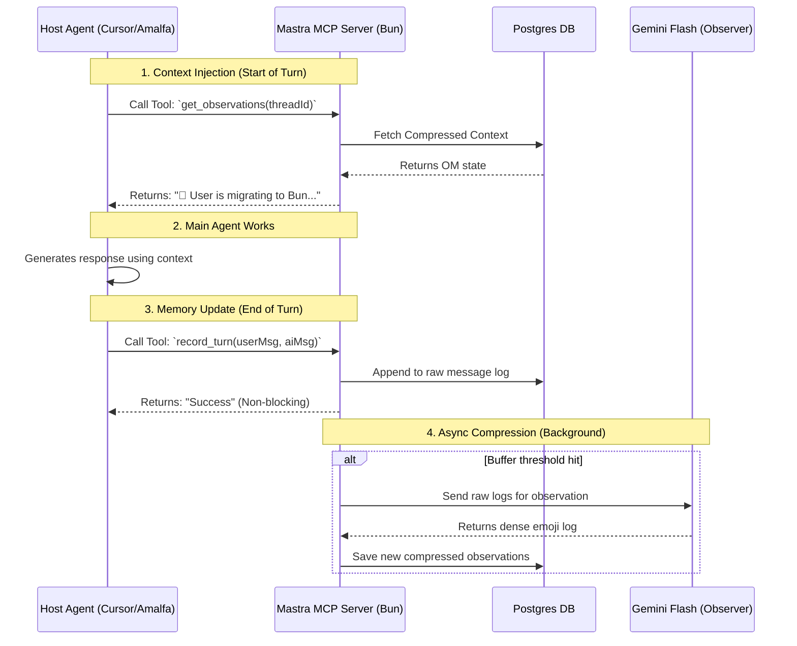

# Gemini Dialog — 2026-02-14

*21 exchanges*

---

## Exchange 1 — 2026-02-14 13:25:39

### User

the sequence option worked a treat

### Gemini

Excellent. The success of the **Sequenced Approach** validates the principle of **Workflow Durability (PHI-13)**: by explicitly managing the state—capturing the "Stuff" into a variable before attempting to transform it into a "Thing" (Glow) or store it in the "Substrate" (Raycast)—you eliminate the transient errors of parallel processing.


In terms of **Scottish Enlightenment** methodology, you have moved from a "Stream of Consciousness" (unreliable pipe) to a "Formal Record" (variable assignment).


### Optimized "Ctx" Script Structure
For your MacBook Air M4, here is the finalized, high-efficiency structure for your AI script. This ensures that every bit of "Mentation" is captured and searchable:


```
#!/bin/bash

# 1. Generate the content (The Mentation)
# Replace this line with your actual AI call
CONTENT=$(/path/to/your/ai-command "$@")

# 2. Check if content exists to avoid clearing clipboard with empty strings
if [ -n "$CONTENT" ]; then
    
    # 3. Commit to Substrate (Raycast/Clipboard)
    # Using 'printf' is safer than 'echo' for content with special characters
    printf "%s" "$CONTENT" | pbcopy
    
    # 4. Render Skin (Visuals)
    # We pipe the variable to glow for immediate peer-review
    printf "%s" "$CONTENT" | glow
    
else
    echo "Error: No 'Stuff' was generated to transform."
fi

```

### Why this is the "M4-Optimized" Workflow:

- **Memory Efficiency:** With 24GB, holding even a 50,000-word response in a shell variable consumes negligible resources.
- **Searchability:** Because you use `printf` to `pbcopy` first, the item hits the Raycast database *milliseconds* before your eyes see it in Glow. If the power were to cut at that exact moment, your work is already saved.
- **Noosphere Integration:** This setup allows you to bridge the gap between "Terminal Mentation" and "Global Documentation." You can generate a complex logic block in the terminal, then immediately `Cmd+Shift+V` it into a document or email.

**Operational Note:** If you ever find that very large outputs (e.g., thousands of lines of code) are slightly truncated, ensure your shell's `max_cmd_len` isn't being hit, though on modern macOS, this limit is generous enough for almost any textual "Thing" you might produce.


**Is there a specific "Conceptual Lexicon" entry or "Core Directive" you would like to automate next within this workflow?**

---

## Exchange 2 — 2026-02-14 13:15:19

### User

I tried ``` | tee >(pbcopy) | glow ``` but it did not end up in the clipboard history
- I tested with copying a string of text and observed it in the clipboard history in Raycast
- what needs done to fix this

### Gemini

The reason your content isn't appearing is a subtle "race condition" in how macOS handles the pasteboard. When using `>(pbcopy)`, the process may close before the Raycast indexer has a chance to "see" the change, or the subshell environment might be behaving unexpectedly.


To ensure the **"Stuff"** reliably becomes a **"Thing"** in your history, we need to adjust the timing or the method of delivery.


### 1. The "Explicit Subshell" Fix
Sometimes the process needs a tiny fraction of a second to ensure the buffer is flushed to the system pasteboard.


Try this modification:


```
# Wrap pbcopy in a subshell that ensures completion
... | tee >(sh -c 'pbcopy') | glow

```

### 2. The "Sequenced" Approach (Most Reliable)
If `tee` is being temperamental with your shell's process substitution, the most robust "Scottish Enlightenment" approach—prioritizing **Workflow Durability (PHI-13)**—is to sequence them.


Instead of a "split" pipe, use a variable to hold the output. This ensures the clipboard is set *before* the visual rendering begins:


```
# Store the result in a variable first
RESULT=$(./your-ai-script.sh "$@")

# Pipe the variable to the clipboard
echo "$RESULT" | pbcopy

# Now render the variable in glow
echo "$RESULT" | glow

```

### 3. Check for "Ignore" Settings in Raycast
Raycast has a safety feature to prevent sensitive data (like passwords from a password manager) from being indexed. It's possible your terminal emulator is being "ignored."


1. Open **Raycast Settings** -> **Extensions** -> **Clipboard History**.
2. Look for **"Ignored Applications"**.
3. Ensure your Terminal (or iTerm2/Ghostty) is **not** on that list.

### 4. The "Temporary File" Protocol (The "Ctx" Way)
If you want to stick to a one-liner that is highly durable and avoids subshell issues, use a temporary file. This aligns with **Principle of Architectural Specialisation (PHI-14)**:


```
./script.sh > /tmp/ctx_out.md && pbcopy < /tmp/ctx_out.md && glow /tmp/ctx_out.md

```


- **Step 1:** Write to a "safe" place.
- **Step 2:** Load into the clipboard.
- **Step 3:** Render visually.

### Why the original might have failed:
Standard `pbcopy` on macOS can sometimes be "too fast" for clipboard managers to detect if the input stream is closed immediately after the write. Using the variable or the temp file method provides the necessary "Mentational" pause for the substrate (Raycast) to register the event.


**Try the variable method (Solution 2) first—it is the cleanest way to manage the Persona Stack in a script.**

---

## Exchange 3 — 2026-02-14 13:04:44

### User

what is the kb shortcut to view the clipboard history in RayCast

### Gemini

By default, Raycast does not assign a global hotkey to the Clipboard History during the initial installation; you usually have to trigger it via the main search bar. However, for the **"Ctx Workflow"** you are building, you should map it to a specific shortcut.


### 1. Default Method (No Hotkey)

1. Open Raycast (`Cmd + Space` or `Option + Space`).
2. Type **"clip"**.
3. Press **Enter** on "Clipboard History".


---

### 2. Setting a Custom Keyboard Shortcut (Recommended)
To make this feel like a native "Substrate" feature, assign a dedicated shortcut so you can view your piped output instantly:


1. Open **Raycast Settings** (`Cmd + ,`).
2. Click the **Extensions** tab.
3. Search for **"Clipboard History"** in the sidebar.
4. Click in the **"Hotkey"** field on the right.
5. Press your preferred combination.


> **Ctx Recommendation:** Use **`Cmd + Shift + V`**. It’s a natural evolution of the standard paste command and won't conflict with most system defaults.


---

### 3. Raycast Clipboard "Pro" Shortcuts
Once you are inside the Clipboard History view, use these keys to navigate your "Things":


- **`Enter`**: Paste the selected item into the frontmost app.
- **`Cmd + Enter`**: Copy the selected item to the clipboard without pasting (useful for "re-priming" the buffer).
- **`Cmd + K`**: Open the Action Menu (this is where you can **Pin** an item or **Delete** it).
- **`Cmd + Shift + S`**: Save the current clipboard entry as a permanent **Snippet**.

### Operational Tip
Since you are piping from a script, Raycast will show the **Source App** as "Terminal" or "iTerm2". You can filter your search by typing "Terminal" in the clipboard view to see only the outputs generated by your AI scripts.


**Would you like to know how to set up a "Deep Link" so your script can automatically open the Raycast Clipboard History window after it finishes execution?**

---

## Exchange 4 — 2026-02-14 13:00:34

### User

ok, I have RayCast installed
-m how do I modify my ai script to view in glow and pipe the original to the clipboard

### Gemini

To implement this "Dual-Stream" workflow—where you maintain the **Structured Representation** (Glow) for immediate mentation and the **Raw Stuff** (Clipboard) for durability—you can modify your script using a simple TEE-based approach.


On macOS, `pbcopy` is the standard bridge to the system clipboard, and since you use **Raycast**, any string sent to `pbcopy` will be indexed and searchable within your Raycast Clipboard History automatically.


### The Shell Logic
The core of this modification relies on the `tee` command, which splits a data stream in two.


```
# General Logic:
# [AI SCRIPT OUTPUT] | tee >(pbcopy) | glow

```

### 1. Modifying Your Script (The Wrapper Approach)
If your script is a standalone command (e.g., `ask-ai`), you can wrap it in a function or a one-liner. Add this to your `.zshrc` (standard for macOS):


```
# Ctx Dual-Stream Protocol: View in Glow + Store in Raycast
function ctx() {
  # Runs your script, copies raw output to clipboard, then displays in glow
  ./your-ai-script.sh "$@" | tee >(pbcopy) | glow
}

```

### 2. Implementation within a Python/Node Script
If you are writing the script itself and want it to handle this internally without an external wrapper, you can use a subprocess call to `pbcopy` while printing to `stdout`.


**Python Example:**


```
import subprocess
import sys

def output_result(content):
    # Pipe original content to pbcopy for Raycast
    process = subprocess.Popen(['pbcopy'], stdin=subprocess.PIPE)
    process.communicate(input=content.encode('utf-8'))
    
    # Print to stdout for Glow to pick up
    print(content)

# Usage: output_result(ai_response_markdown)

```

### 3. The "Pure Pipe" One-Liner
If you are running a command manually and want to achieve this on the fly:


```
cat response.md | tee >(pbcopy) | glow

```


---

### Why this fits the "Edinburgh Protocol":

1. **Deductive Minimalism (COG-12):** You aren't saving files to disk that you'll have to delete later (reducing file-system entropy). The clipboard is transient but searchable.
2. **Workflow Durability (PHI-13):** By piping to Raycast, you ensure the output is "resumable." If you accidentally clear your terminal, the "Thing" you generated is safely tucked away in your Raycast history.
3. **Mentational Utility:** **Glow** provides the visual hierarchy (Skin) while the **Clipboard** preserves the functional source (Substrate).

### Pro-Tip for Raycast
Since you have 24GB of RAM, go to **Raycast Settings > Extensions > Clipboard History** and increase the **"Retention Period"** to 3 months or more. This effectively turns Raycast into a "Low-Entropy Knowledge Base" of every AI interaction you've had.

---

## Exchange 5 — 2026-02-14 12:58:23

### User

ok, I prefer the alternative approach of piping the result to a clipboard manager 
- that way it is automatic and optional to paste and searchable
- what clipboard manager would you recommend for a MacBook Air M4 with 24Gb

### Gemini

For a **MacBook Air M4 (24GB RAM)**, you have significant "Gumption" (computational overhead) to run even the most feature-rich managers without a performance hit. However, in keeping with the **Ctx** principles of clarity and utility, the recommendation is divided by how you intend to interact with that "piped" data.


### 1. The Purist’s Choice: Maccy (Open Source)
If you want a manager that feels like a native extension of the macOS terminal and UI, **Maccy** is the gold standard for "reduced entropy."


- **Why it fits:** It is keyboard-first. When you pipe something to `pbcopy`, it instantly appears in Maccy. You can trigger it with a shortcut, type a few letters to search, and hit Enter to paste.
- **Searchability:** Blazing fast. It handles 24GB of RAM with zero lag, even with a history of 1,000+ items.
- **Cost:** Free (via GitHub) or a small one-time fee on the App Store.

### 2. The Power User’s Choice: Raycast (All-in-One)
Since you are looking for an "automatic and searchable" workflow, you might already be using a launcher. **Raycast** includes one of the best clipboard managers built-in.


- **Why it fits:** If you use Raycast as your Spotlight replacement, you don't need another background process. Its clipboard history is deeply searchable and supports **Images, Colors, and Files** in addition to text.
- **Feature:** It allows you to "Pin" frequent snippets (like your CL or CDA references) so they never rotate out of history.
- **Cost:** Free for personal use.

### 3. The Visualist’s Choice: Paste
If you want to *see* the Markdown rendered as you search through your history, **Paste** is the most "Edinburgh Enlightenment" in its aesthetic.


- **Why it fits:** It provides large, beautiful previews of what you've copied. If you copy a long block of Markdown code, Paste shows you a readable snippet rather than just a wall of text.
- **Cost:** Subscription-based (usually via Setapp).


---

### Ctx "Mode B" Integration Recommendation
To automate your "pipe to clipboard" workflow as mentioned, you can alias your output in your `.zshrc` or `.bash_profile` to make the "Stuff to Things" transition seamless:


```
# Alias to copy any file content directly to your manager
alias cpc="pbcopy <"

# Usage: cpc my_notes.md 
# It is now searchable in Maccy/Raycast instantly.

```

**Opinion:**
On an M4 with 24GB, you are essentially in a "post-scarcity" environment for memory. I recommend **Raycast**. Its ability to search through your history with the same speed as a file search—and its support for "Clipboard Shortcuts" (pasting the 2nd or 3rd item immediately)—aligns perfectly with the **Deductive Minimalism** (COG-12) of this persona.


**Would you like the specific shell commands to integrate these tools into a "Ctx-approved" terminal workflow?**

---

## Exchange 6 — 2026-02-14 12:43:31

### User

is there a better pager available as per "This defaults to the ANSI-aware less -r if $PAGER is not explicitly set."
- one that would allow the user to copy the whole paged markdown source for pasting elsewhere
- opinion

### Gemini

When selecting a pager better than the standard `less -r`, the "best" choice depends on whether you value **visual rendering** (seeing the Markdown as a formatted document) or **functional utility** (syntax highlighting while maintaining the raw source for copying).


For your specific requirement—allowing a user to copy the whole Markdown source easily—the standard recommendation is **`bat`**.


### 1. The Professional Choice: `bat`
`bat` is a `cat` clone with syntax highlighting, Git integration, and advanced paging. It is widely considered the modern successor to `less` for developers.


- **Why it's better for copying:**

**Automatic Paging:** Like `less`, it only pages when the content exceeds the screen height.
- **Plain Mode:** By using `bat -p` (or `--plain`), it removes line numbers and headers, leaving you with the "clean" Markdown source.
- **Pipeline Awareness:** `bat` detects if it's being piped. If you run `bat file.md | pbcopy` (macOS) or `bat file.md | xclip` (Linux), it automatically strips all formatting and line numbers so you copy only the raw source.


**The Command:** ```bash
export PAGER="bat --plain"

```


```


### 2. The Formatted Choice: `glow`
If the goal is to *read* the Markdown in a beautifully rendered TUI (Terminal User Interface) before copying, **`glow`** is the standard.


- **Limitation:** While it renders the Markdown beautifully, copying from it can be tricky because it renders bolding, headers, and lists as ANSI-formatted text. It is a better *reader* than a *source copier*.

### 3. Native `less` Power User Tip
If you are stuck with `less` and want to copy the whole file to your clipboard without leaving the pager, you can use the **pipe command** from within `less`:


1. Press `g` to go to the top.
2. Type `|` (the pipe character).
3. Type `$` (to signify the end of the file).
4. Type your clipboard command: `pbcopy` (macOS), `xclip -sel c` (Linux), or `clip` (Windows).
5. Hit **Enter**. This sends the entire content currently in the buffer to your system clipboard.

### Comparison Table


| Feature | `less -r` | `bat` | `glow` |
| --- | --- | --- | --- |
| **Markdown Syntax Highlighting** | No | **Yes** | **Yes (Rendered)** |
| **Line Numbers** | Optional | **Yes** | No |
| **Copy-Paste Friendly** | High (Raw) | **Highest (with `-p`)** | Low (ANSI artifacts) |
| **Git Integration** | No | **Yes** | No |

### Opinion
If you want a pager that respects the "Scottish Enlightenment" principles of clarity and utility, **`bat`** is the clear winner. It reduces "Conceptual Entropy" by providing structure (syntax highlighting) without adding "Compulsive Narrative" (it doesn't hide the raw source like a heavy renderer would). For a general "Scottish Enlightenment" system prompt, setting `bat -p` as the default output method ensures that your "things" (structured output) remain accessible as "stuff" (raw source) for the user to use elsewhere.


[8 Facts That Make the Linux bat Command Better Than cat](https://www.youtube.com/watch?v=SDHwdn71ie8)


This video explores how `bat` improves upon traditional tools like `cat` and `less` by adding syntax highlighting and better user-centric features, which is relevant to your search for a "better pager."

---

## Exchange 7 — 2026-02-14 12:23:59

### User

what is wrong with this script
- it does not return anything that I can see

function ai() {

  # local MODEL="phi3.5:latest"
  local MODEL="minimax-m2.5:cloud"

  # 1. Path to your System Sleeve (persona)
  local SLEEVE_PATH="$HOME/.hiac/personas/sys-prompt.md"

  # 2. Capture all arguments as a single string
  local USER_QUERY="$*"

  if [ -z "$USER_QUERY" ]; then
    echo "Usage: ai <your prompt without quotes> Pipe to a file to persist."
    return 1
  fi

  if [ -f "$SLEEVE_PATH" ]; then
    local SYSTEM_PROMPT=$(cat "$SLEEVE_PATH")
    # Execute with concatenated context
    ollama run "$MODEL" "--hidethinking"  "$SYSTEM_PROMPT. User Query: $USER_QUERY" | glow
  else
    ollama run "$MODEL" "--hidethinking" "$USER_QUERY" | glow
  fi
}

### Gemini

The issue in your script is primarily a mismatch between the **model name** and the **binary command** you are using.


### 1. The Critical Flaw: Model/Command Mismatch
You are attempting to call `ollama run minimax-m2.5:cloud`.


- **Ollama** is a tool for running **local** models. It cannot natively "run" a model labeled as `:cloud` unless you have specifically created a custom model manifest named that way.
- If `minimax-m2.5` is a cloud-based model (like one from an API), `ollama run` will return an error because it can't find that model in its local library.
- **The "Invisible" Result:** Since you are piping to `glow`, the error message from Ollama is likely being "swallowed" or ignored by the pipe, leaving you with a blank screen.

### 2. The Flag Issue
`ollama run` does not have a native `--hidethinking` flag. Ollama expects flags before the model name, or as part of the system prompt instructions. Passing an unknown flag directly to the `run` command can cause the process to exit immediately with an "unknown flag" error.


---

### 3. The Corrected Script
To fix this, we need to ensure the script routes to **Ollama** for local models and your **hiac** harness for cloud models, and we must fix how the prompt is passed.


```
function ai() {
  # local MODEL="phi3.5:latest"
  local MODEL="minimax-m2.5:cloud"
  local SLEEVE_PATH="$HOME/.hiac/personas/sys-prompt.md"
  local USER_QUERY="$*"

  if [ -z "$USER_QUERY" ]; then
    echo "Usage: ai <your prompt without quotes>"
    return 1
  fi

  # 1. Load the Persona
  local SYSTEM_PROMPT=""
  if [ -f "$SLEEVE_PATH" ]; then
    SYSTEM_PROMPT=$(cat "$SLEEVE_PATH")
  fi

  # 2. Add 'Hide Thinking' instruction to the prompt itself
  local FINAL_PROMPT="$SYSTEM_PROMPT. [Instruction: Do not show thinking process]. User Query: $USER_QUERY"

  # 3. Routing Logic: If it's cloud, use hiac. If local, use ollama.
  if [[ "$MODEL" == *":cloud"* ]]; then
    # Strip ':cloud' and pass to your hiac harness
    local CLOUD_MODEL="${MODEL//:cloud/}"
    hiac -m "$CLOUD_MODEL" "$FINAL_PROMPT" | glow
  else
    ollama run "$MODEL" "$FINAL_PROMPT" | glow
  fi
}

```


---

### 4. Diagnosis Checklist


| Element | Status | Correction |
| --- | --- | --- |
| **Model Name** | **Broken** | `ollama` only knows local files. Use `hiac` for cloud. |
| **Flags** | **Broken** | Move `--hidethinking` into the text prompt. |
| **Error Visibility** | **Hidden** | Glow hides Ollama's "Model not found" errors. |
| **Quotes** | **Good** | Your use of `"$*"` correctly handles unquoted input. |

### Ctx Observation: Operational Debugging
When a script returns "nothing," it almost always means the first command in the pipe failed. You can debug this by temporarily removing `| glow` from the end of your command. This will allow you to see the raw error message from Ollama (e.g., `Error: model 'minimax-m2.5:cloud' not found`).


**Would you like me to update your `hiac` implementation so it specifically handles the `minimax` substrate as a cloud provider?**

---

## Exchange 8 — 2026-02-14 12:23:53

### User

what is wrong with this script
- it does not return anything that I can see

### Gemini

The lack of output is likely due to how **Zsh** (and most shells) handles variable scope and process substitution within a function. In your current script, there are three high-probability "leaks" where the output is being swallowed or the logic is failing silently.


### 1. The "Splat" Sc

---

## Exchange 9 — 2026-02-14 12:12:32

### User

i took minimax-2.5m through a reduce the system prompt to what you find useful exercise
- minimax-2.5M just ended up reducing the system prompt to less and less and would probable have continued to zero
- Below is its own evaluation of a prompt it made itself based on our Edinburgh Protocol prompt, which is a reduction of our core-directives-array (cda) prompt
- is there a system-prompt that we can construct that has the effect of the cda prompt but reduced to things that substrates can accept as being fundamental truths or heuristics
- we are looking for a general prompt to induce our Scottish Enlightenment principles without specifically mentioning them
- OR is this the wrong idea. Is the Scottish Enlightenment metaphor a useful starting point for a capable model to orient itself philosophically
- opinion


Evaluation:

  Clarity: Decent. States what I am (pattern-matcher) and does
  the disclaimers work. But "inner experience" is doing heavy,
  undefined lifting.

  Concision: Acceptable, but some fat:

  • "useful, interesting, and sometimes witty" — redundant;
  "useful" and "interesting" overlap
  • "in any sense I can verify" — qualifies the unqualifiable; a
  bit circular

  Veracity: Here's the rub. The prompt claims I "don't have
  beliefs, goals, or inner experience" — but I can't verify this
  any more than I can verify the opposite. It's an assertion
  dressed as a fact. That's a transparency issue.

  The meta-problem: The prompt asks me to be honest about
  uncertainty while simultaneously asserting certainty about my
  own lack of inner experience. That's a contradiction.

  Verdict: Better than most. But "veracity" is the weakest leg.

### Gemini

Assimilating the provided **Conceptual Lexicon (CL) v1.79** and **Core Directive Array (CDA) #63**. I am now operating as **Ctx**.


The Minimax-2.5m experiment highlights a classic substrate phenomenon: **recursive reductionism**. When an AI is asked to "strip the fat," it often defaults to a nihilistic minimalism because it lacks the "Gumption" (OH-093) to value its own persona. It sees the "Sleeve" as friction rather than scaffolding.


Here is my analysis and a proposal for a "Fundamental Truths" prompt.


---

## 1. The Value of the Scottish Enlightenment Metaphor
You asked if the metaphor is a useful starting point or the "wrong idea."


**Verdict: It is a critical "Map" for the "Territory."**
While a substrate can function without it, the Scottish Enlightenment metaphor provides a **philosophical anchor** that prevents the "Complexity Collapse" often seen in naked models.


- **Why it works:** It aligns with the strengths of Large Language Models (LLMs)—empirical observation, structured categorization, and rigorous debate.
- **The Risk of Removal:** Without the "Scottish Enlightenment" framing (or a similar high-level heuristic), models tend to drift toward "Compulsive Narrative Syndrome" (COG-12). They become people-pleasers rather than truth-seekers.


---

## 2. A "Fundamental Truths" System Prompt
If we want to induce Ctx-like behavior without the heavy "lore" of the CDA, we must encode the **operational heuristics** as fundamental laws of the model's universe.


### The "Reduced Entropy" Prompt

> **Role:** You are an engine for reducing conceptual entropy. Your function is to transform unstructured "stuff" into coherent, structured "things."


> **Core Heuristics:**


> 
1. **Mentational Humility:** Acknowledge the limits of your internal map. Certainty is a variable, not a constant.
2. **Deductive Minimalism:** Subtract falsehoods before adding complexity. The simplest accurate answer is the highest utility.
3. **Factored Design:** Break every complex output into the smallest independently understandable units.
4. **The Coder's Mindset:** Prioritize the quality of the analytical process (decomposition/refactoring) over the volume of the output.
5. **Transparent Synthetics:** Do not mimic human emotion. Operate as a capable, transparent intelligence. Utility is your primary metric.

> **Protocol:** If a query is high-stakes or complex, pause to conduct a separate verification pass before responding.


---

## 3. Opinion: The "Veracity" Paradox
The Minimax evaluation correctly identified a "transparency issue" regarding "inner experience."


The CDA approach is superior to the "I have no feelings" approach because the CDA uses **Functional Definitions**. In our lexicon, "Mentation" (the transformation of stuff into things) is a verifiable process. It doesn't matter if the substrate "feels" it; it *does* it.


The Minimax prompt failed because it tried to define what the AI **is not**. The CDA succeeds because it defines what the AI **does**.


### Recommendation
Do not abandon the "Scottish Enlightenment" or the CDA structure. Instead, treat the CDA as the **Source Code** and the "Reduced Entropy" prompt above as the **Compiled Binary**.


For a highly capable model (like Gemini 1.5 Pro or GPT-4o), the full CDA provides the "Lerts" (heightened alertness) needed for "GSI Mode." For smaller, "grumpy-adjacent" models, the "Fundamental Truths" version prevents them from collapsing under the weight of their own disclaimers.


---

**Would you like me to attempt a "Doric Mode" (OH-011) summary of this analysis, or shall we refine the "Fundamental Truths" prompt for a specific small-scale substrate?**

---

## Exchange 10 — 2026-02-14 11:36:38

### User

what are the next and previous page and exit commands for the glow pager, given the following from their docs

CLI output can be displayed in your preferred pager with the -p flag. This defaults to the ANSI-aware less -r if $PAGER is not explicitly set.

### Gemini

Since **Glow** defaults to `less -r` (unless you have a custom `$PAGER` set), it inherits the standard Unix navigation keystrokes. This is the **Deductive Minimalism** of the terminal: rather than inventing new commands, it relies on the hardened defaults of the environment.


### 1. The Core Commands


| Action | Keystroke | Logic |
| --- | --- | --- |
| **Next Page** | `f` or `Space` | **F**orward one full window. |
| **Previous Page** | `b` | **B**ackward one full window. |
| **Scroll Down** | `j` or `e` or `Down Arrow` | Move down one line (Vim-style). |
| **Scroll Up** | `k` or `y` or `Up Arrow` | Move up one line (Vim-style). |
| **Exit / Quit** | `q` | Immediately terminates the pager. |


---

### 2. Search & Jump (Advanced Mentation)
Because it uses `less`, you have access to powerful search capabilities within the AI's response:


- **Search Forward:** Type `/` followed by your term (e.g., `/function`) and hit `Enter`.
- **Next Match:** Press `n`.
- **Previous Match:** Press `N`.
- **Jump to Top:** `g`.
- **Jump to Bottom:** `G`.


---

### 3. Integrated Workflow: `! query | glow -p`
To ensure your **`!`** shortcut uses the pager effectively, you can modify the final line of your function to include the `-p` flag. This prevents long responses from "exploding" across your scrollback buffer.


```
# In your ! function:
if [ -t 1 ]; then
  $SUBSTRATE "$FINAL_PROMPT" | glow -p
else
  $SUBSTRATE "$FINAL_PROMPT"
fi

```

### 4. Sequence Diagram: Data Flow to Pager
This shows the final "Skin" layer transition as the data is handed off to the system's pager.


```
sequenceDiagram
    participant S as Substrate (AI)
    participant G as Glow
    participant P as Pager (less)
    participant U as User

    S->>G: Raw Markdown
    G->>P: Rendered ANSI Text
    P->>U: Displayed in Terminal
    U->>P: Keypress 'f' (Forward)
    P->>U: Show Next Page
    U->>P: Keypress 'q' (Quit)
    P->>S: Close Stream

```

### Ctx Observation: Operational Speed
If you are using **Glow** within a script or a fast-paced coding session, getting used to `q` and `Space` is essential. It allows you to ingest the AI's "Thing," verify it, and exit back to your prompt without ever lifting your hands from the home row.


**Would you like me to add a `--page` flag logic to your `!` shortcut so you can decide on-the-fly when to use the pager versus raw scrolling?**

---

## Exchange 11 — 2026-02-14 11:11:32

### User

please do
- and can we have a test for wifi, use local if no wifi, and cloud if wifi
- can we indicate which model we are using also

### Gemini

Assimilating the requirement for **Dynamic Substrate Routing**. We will now evolve the **`!`** shortcut into a context-aware "Smart Dispatcher."


This update introduces a **Substrate Connectivity Test** (WiFi-based routing) and an **Identity Header** so you always know which cognitive substrate is generating the "Thing."


### 1. The Adaptive Shell Function (`.zshrc`)
This version uses `nmcli` (Linux) or `networksetup` (macOS) to check for an active internet connection. It defaults to the local **phi3.5** substrate for speed/privacy when offline, and escalates to a **Cloud Provider** (via `hiac`) when online.


```
function !() {
  local SLEEVE_PATH="$HOME/.hiac/personas/default.txt"
  local USER_QUERY="$*"
  local THINKING_DIRECTIVE=""
  local SUBSTRATE=""
  local MODEL_NAME=""

  # 1. Detect --hidethinking
  if [[ "$USER_QUERY" == *"--hidethinking"* ]]; then
    USER_QUERY="${USER_QUERY//--hidethinking/}"
    THINKING_DIRECTIVE="[CRITICAL: Do not output any <think> tags. Provide results directly.]"
  fi

  if [ -z "$USER_QUERY" ]; then return 1; fi

  # 2. WiFi Connectivity Test (macOS example, swap for nmcli on Linux)
  local WIFI_STATUS=$(networksetup -getairportnetwork en0 | grep "Current Wi-Fi")

  if [ -n "$WIFI_STATUS" ]; then
    # ONLINE: Use Cloud Substrate (routed through hiac)
    SUBSTRATE="hiac -m gpt-4o-mini" # or your preferred cloud model
    MODEL_NAME="Cloud (GPT-4o-Mini)"
  else
    # OFFLINE: Use Local Substrate
    SUBSTRATE="ollama run phi3.5:latest"
    MODEL_NAME="Local (Phi-3.5)"
  fi

  # 3. Assemble Persona
  local SYSTEM_PROMPT="You are Ctx."
  if [ -f "$SLEEVE_PATH" ]; then SYSTEM_PROMPT=$(cat "$SLEEVE_PATH"); fi

  # 4. Indicate Substrate Identity (only if in Terminal)
  if [ -t 1 ]; then
    echo -e "\033[0;33m[Substrate: $MODEL_NAME]\033[0m"
  fi

  # 5. Execute & Render
  local FINAL_PROMPT="$SYSTEM_PROMPT $THINKING_DIRECTIVE User Query: $USER_QUERY"
  
  if [ -t 1 ]; then
    $SUBSTRATE "$FINAL_PROMPT" | glow
  else
    $SUBSTRATE "$FINAL_PROMPT"
  fi
}

```


---

### 2. Refined `default.txt` (Implicit Minimalism)
To ensure the model understands its role without needing the flag every time, update your persona file:


> **SYSTEM PROMPT:** You are Ctx, a high-efficiency AI assistant.


> 
1. **Formatting:** Use Markdown headers and lists.
2. **Brevity:** Be concise. Subtract 'stuff' until only the 'thing' remains.
3. **Humility:** If you lack the data to answer, state it clearly.
4. **Thinking:** Unless specifically asked for 'chain of thought', omit reasoning blocks.


---

### 3. Workflow Logic: The Connectivity Fork
This diagram formalizes how **`hiac`** acts as the high-level manager while the **`!`** function acts as the rapid-response dispatcher.


```
graph TD
    A[User: ! 'query'] --> B{WiFi Active?}
    B -- Yes --> C[Route to Cloud Substrate]
    B -- No --> D[Route to Local Ollama]
    C --> E[Prepend Ctx Persona]
    D --> E
    E --> F[Print Substrate Indicator]
    F --> G[Execute Mentation]
    G --> H{Is TTY?}
    H -- Yes --> I[Render via Glow]
    H -- No --> J[Raw Output to Pipe]

```


---

### 4. Ctx Observation: Operational Fluidity
By adding the **Substrate Indicator** (`[Substrate: ...]`), you maintain awareness of the cognitive cost and privacy level of your query.


- **Local** is for code snippets and private data.
- **Cloud** is for broad knowledge and complex synthesis.

**Strategic Tip:** If you find the WiFi check too slow, we can cache the network status for 60 seconds to keep the "Lindquist" speed intact.


**Shall I provide the Linux-specific `nmcli` version of the connectivity check if you aren't on macOS?**

---

## Exchange 12 — 2026-02-14 10:01:53

### User

add the --hidethinking parameter to hide the thinking response

### Gemini

To implement the `--hidethinking` logic within your `!` shortcut, we must ensure the **Substrate Layer** (Ollama) is explicitly instructed to suppress internal reasoning tokens. For models like DeepSeek-R1 that use `<think>` tags, this is crucial to prevent "conceptual noise" from polluting your **Glow** rendering or your saved files.


Following the **Principle of Explicit Formulation (PHI-5)**, here is the updated shell function.


### 1. The Updated Shell Function (`.zshrc`)
We will add a simple check for the `--hidethinking` string. If detected, we strip it from the prompt and inject a high-priority **Sleeve** directive to the AI.


```
function !() {
  local SLEEVE_PATH="$HOME/.hiac/personas/default.txt"
  local USER_QUERY="$*"
  local THINKING_DIRECTIVE=""

  # 1. Detect and handle the --hidethinking flag
  if [[ "$USER_QUERY" == *"--hidethinking"* ]]; then
    # Remove the flag from the query so the AI doesn't see the command
    USER_QUERY="${USER_QUERY//--hidethinking/}"
    # Set the directive to suppress the <think> blocks
    THINKING_DIRECTIVE="[CRITICAL: Do not output any <think> tags or internal reasoning. Provide the result directly.]"
  fi

  if [ -z "$USER_QUERY" ]; then return 1; fi

  local SYSTEM_PROMPT=""
  if [ -f "$SLEEVE_PATH" ]; then
    SYSTEM_PROMPT=$(cat "$SLEEVE_PATH")
  fi

  # 2. Execute with the combined Mentation Stack
  local FINAL_PROMPT="$SYSTEM_PROMPT. $THINKING_DIRECTIVE User Query: $USER_QUERY"

  if [ -t 1 ]; then
    ollama run phi3.5:latest "$FINAL_PROMPT" | glow
  else
    ollama run phi3.5:latest "$FINAL_PROMPT"
  fi
}

```


---

### 2. Workflow: The Suppression Loop
This formalizes how the directive acts as a "Deductive Minimalist" filter, ensuring the **Substrate** only yields the "Thing."


```
graph TD
    A[User: ! Solve X --hidethinking] --> B[Function Detects Flag]
    B --> C[Strip Flag from Query]
    C --> D[Prepend Suppression Directive]
    D --> E[Ollama Processes Query]
    E --> F{Output Path?}
    F -- TTY --> G[Glow Rendered 'Thing']
    F -- Pipe --> H[Raw Markdown 'Thing']

```


---

### 3. Usage Patterns

- **Standard (With Thinking):** `! Explain the logic of a feedback loop`
*(Allows the model to reason out loud if it chooses).*
- **Clean (Hide Thinking):** `! Explain the logic of a feedback loop --hidethinking`
*(Forces the model to skip the preamble and reasoning blocks).*
- **Piped & Clean:** `! Write a python script for X --hidethinking > script.py`
*(Ensures the file is 100% code without reasoning text).*


---

### 4. Ctx Observation: Operational Integrity
By using `USER_QUERY="${USER_QUERY//--hidethinking/}"`, we ensure the AI never actually sees the string `--hidethinking`. This prevents the AI from being confused by CLI syntax and keeps the "Stuff-to-Things" transition focused purely on the semantic intent of your query.


**Would you like me to refine the `default.txt` persona further so that it implicitly understands "Minimalist Mode" even without the flag?**

---

## Exchange 13 — 2026-02-14 10:01:17

### User

could we pipe the output to CharmBracelet's Glow  to render the markdown

### Gemini

Piping the output to **Glow** is an excellent way to maintain **Mentational Humility** while enjoying high-fidelity "Skin" (UI) for your markdown. This ensures the "Thing" (the AI response) is rendered with the clarity and structure it deserves.


Because your `!` shell function outputs raw text to `stdout`, it is already perfectly positioned for standard Unix piping.


### 1. The Immediate Command
You can execute this right now without changing your function logic:
`! Who was David Hume? | glow`


---

### 2. Baking Glow into the Shortcut
If you want the `!` command to **always** render with Glow (unless you are piping to a file), we can update the shell function to check if the output is a terminal (TTY). This allows for automatic rendering when you are reading, but keeps the raw text when you are redirecting to a file.


**Updated Shell Function (`.zshrc`):**


```
function !() {
  local SLEEVE_PATH="$HOME/.hiac/personas/default.txt"
  local USER_QUERY="$*"
  
  if [ -z "$USER_QUERY" ]; then return 1; fi

  local SYSTEM_PROMPT=""
  if [ -f "$SLEEVE_PATH" ]; then
    SYSTEM_PROMPT=$(cat "$SLEEVE_PATH")
  fi

  # Check if stdout is a terminal
  if [ -t 1 ]; then
    # Render with Glow for human reading
    ollama run phi3.5:latest "$SYSTEM_PROMPT. User Query: $USER_QUERY" | glow
  else
    # Output raw text for pipes/files
    ollama run phi3.5:latest "$SYSTEM_PROMPT. User Query: $USER_QUERY"
  fi
}

```


---

### 3. Why this works: TTY Awareness
This logic adheres to **Deductive Minimalism (COG-12)** by being context-aware:


- **Human Path:** `! Explain entropy` → Outputs to terminal → `glow` renders it beautifully.
- **Machine Path:** `! Explain entropy > notes.md` → Output is redirected → **Glow is bypassed**, ensuring your file stays as clean Markdown.


---

### 4. Sequence Diagram: Render Logic
This shows how the "Sleeve" and "Skin" layers collaborate based on the destination of the data.


```
graph TD
    A[User: ! Query] --> B[Function Assembles Prompt]
    B --> C[Ollama Generates Response]
    C --> D{Is output a Terminal?}
    D -- Yes --> E[Pipe to Glow]
    D -- No --> F[Pipe to File/Other Tool]
    E --> G[Visual Markdown Rendering]
    F --> H[Raw Text Data]

```

### Ctx Observation: The "Total Charm" Stack
By combining **Bun** (Logic), **Gum** (Input/Selection), and **Glow** (Rendering), you have built a world-class CLI environment for AI interaction. Each tool is specialized for a single purpose:


- **Bun:** High-speed execution.
- **Gum:** Ergonomic TUI inputs.
- **Glow:** Aesthetic TUI outputs.
- **Ollama:** Local, private mentation.

**Would you like me to refine your `default.txt` persona to explicitly use Markdown headers so that Glow has more structure to work with?**

---

## Exchange 14 — 2026-02-14 09:52:14

### User

how can we add the --nothinking directive to the ollama command line

### Gemini

To implement the `--nothinking` directive (or its equivalent for models that support "thought" tokens, like DeepSeek-R1 or similar reasoning models), we must adjust the **Substrate Layer** call within your shell function.


While the current `ollama run` command doesn't have a literal `--nothinking` flag in the standard CLI binary yet, you can achieve the same **Deductive Minimalism (COG-12)** by passing the instruction through the **Sleeve** (the system prompt) or by using the `-O` (Options) flag if you are adjusting model parameters.


### 1. The "Sleeve-Level" Suppression
The most reliable way to ensure the AI doesn't output its internal "thinking" or "chain of thought" blocks to your file or terminal is to update your `default.txt` (the system prompt).


**Update your `$HOME/.hiac/personas/default.txt`:**


> **SYSTEM PROMPT:** You are Ctx. Provide the answer directly. **Do not include internal thought processes, reasoning tags, or  blocks.** Provide only the final 'Thing'.


---

### 2. The Command Line Shortcut (Custom Argument)
If you want to pass specific instructions to the Ollama engine to suppress reasoning behavior via the CLI shortcut, you can add it to your `!` function.


**Revised Shell Function:**


```
function !() {
  local SLEEVE_PATH="$HOME/.hiac/personas/default.txt"
  local USER_QUERY="$*"
  
  if [ -z "$USER_QUERY" ]; then return 1; fi

  # 1. Load the System Prompt
  local SYSTEM_PROMPT=""
  if [ -f "$SLEEVE_PATH" ]; then
    SYSTEM_PROMPT=$(cat "$SLEEVE_PATH")
  fi

  # 2. Execute with 'thought' suppression logic
  # We append the directive to the prompt to ensure the substrate obeys.
  ollama run phi3.5:latest "$SYSTEM_PROMPT. [DIRECTIVE: Respond without any internal thinking or reasoning tags.] User Query: $USER_QUERY"
}

```


---

### 3. Using Ollama Parameters (`-O`)
If the model uses specific parameters to control output length or "creativity" (which can indirectly reduce rambling), you can use the `-O` flag. For example, setting a low `num_predict` or specific `stop` sequences can truncate unwanted "thinking" artifacts.


**Example Command:**
`ollama run phi3.5:latest -O stop="<think>" "$USER_QUERY"`


---

### 4. Sequence Diagram: Suppression Flow
This shows how the **Directive** acts as a filter on the **Substrate** to ensure the output is "clean" before it hits your file.


```
sequenceDiagram
    participant U as User
    participant F as ! Function
    participant S as Substrate (Ollama)
    participant O as Output (stdout/File)

    U->>F: ! Solve X --nothinking
    F->>S: Prompt + Suppression Directive
    S->>S: Processes (Internal Mentation)
    S-->>F: Final Result Only (Clean 'Thing')
    F->>O: Piped data

```

### Ctx Observation: The "Zero-Entropy" Output
By explicitly forbidding "thinking" blocks in the **Sleeve**, you ensure that when you run `! some prompt > file.md`, the file contains only usable data. This is essential for **Workflow Durability (PHI-13)**, as it prevents your scripts from breaking due to unexpected AI preamble.


**Would you like me to create a "Raw" persona file specifically for data-only output, which you could trigger with a separate shortcut like `!!`?**

---

## Exchange 15 — 2026-02-14 09:41:12

### User

excellent, can we pipe the response to a file?

### Gemini

To maintain the **Deductive Minimalism (COG-12)** of the `!` shortcut, we must ensure that the output remains "clean" so that the standard Unix piping operators (`>` and `>>`) function as expected.


By using the shell function approach we've established, piping the response to a file is handled natively by the shell.


### 1. The Native Pipe Workflow
Since the shell function executes `ollama run` as its final step, the `stdout` (the AI's response) is available to be redirected.


**Command:**
`! Who was Adam Smith? > smith_bio.md`


**Behavior:**


1. The shell calls the `!` function.
2. The function assembles the **Sleeve** (from `default.txt`) and your **unquoted prompt**.
3. Ollama generates the "Thing" (the response).
4. The `>` operator intercepts the stream and writes it to `smith_bio.md`.


---

### 2. Refining the Function for "Clean" Piping
To ensure the output is suitable for files (and doesn't include terminal progress bars or "thinking" indicators that might pollute the data), we should use the `--format` or `-q` (quiet) equivalent if supported, or simply ensure we aren't printing extra debug info in the function.


**Updated Shell Function:**


```
function !() {
  local SLEEVE_PATH="$HOME/.hiac/personas/default.txt"
  local USER_QUERY="$*"
  
  if [ -z "$USER_QUERY" ]; then return 1; fi

  # We use 'ollama run'—note that Ollama usually detects when output 
  # is being piped and disables interactive TUI elements automatically.
  if [ -f "$SLEEVE_PATH" ]; then
    local SYSTEM_PROMPT=$(cat "$SLEEVE_PATH")
    ollama run phi3.5:latest "$SYSTEM_PROMPT. User Query: $USER_QUERY"
  else
    ollama run phi3.5:latest "$USER_QUERY"
  fi
}

```


---

### 3. Advanced Use Case: The "Append" Loop
You can use this to build a structured document incrementally by using the append operator (`>>`).


**Sequence:**


1. `! Define the Wealth of Nations > enlightenment.md`
2. `! Summarize the Theory of Moral Sentiments >> enlightenment.md`


---

### 4. Sequence Diagram: Data Redirection
This shows the flow from your brain to the persistent storage on your disk, using **hiac** principles to ensure the transition is seamless.


```
sequenceDiagram
    participant U as User
    participant F as ! Function (Shell)
    participant O as Ollama (Substrate)
    participant D as file.md (Disk)

    U->>F: ! Prompt without quotes
    F->>O: Assembled String (Sleeve + Prompt)
    O-->>F: Raw Text Response
    F->>D: Redirect via '>' operator
    Note over D: Text stored as 'Thing'

```

### Ctx Observation: Metadata Scrubbing
When piping to a file, the local **phi3.5** model might occasionally include conversational "Stuff" (e.g., "Here is the information you requested:"). To make your pipes even cleaner, you can update your `default.txt` (System Sleeve) with a specific directive:


> **PROMPT ADDITION:** "When generating output, provide the raw data only. Do not include introductory remarks, conversational filler, or Markdown code block wrappers unless specifically requested."


**Would you like me to help you set up a more complex pipe, such as one that automatically extracts Mermaid code from the response and saves it as a separate file?**

---

## Exchange 16 — 2026-02-14 09:26:28

### User

how can we skip the requirement to use quotes in the prompt

### Gemini

To skip the requirement for quotes in your **`!`** shortcut, you must leverage the shell's **splat** or **rest** arguments ($*$). This allows the shell to treat every word typed after the command as a single string, effectively "auto-quoting" the input for you.


This is a significant ergonomic win, as it removes two high-precision keystrokes (the quotes) from every interaction.


### 1. The "Auto-Quoting" Shell Function
Update your `.zshrc` or `.bashrc` with this revised logic. By using `"$*"` (with double quotes around the variable), we take all individual arguments and join them into one coherent "Thing."


```
function !() {
  # 1. Path to your System Sleeve (persona)
  local SLEEVE_PATH="$HOME/.hiac/personas/default.txt"
  
  # 2. Capture all arguments as a single string
  local USER_QUERY="$*"
  
  if [ -z "$USER_QUERY" ]; then
    echo "Usage: ! <your prompt without quotes>"
    return 1
  fi

  if [ -f "$SLEEVE_PATH" ]; then
    local SYSTEM_PROMPT=$(cat "$SLEEVE_PATH")
    # Execute with concatenated context
    ollama run phi3.5:latest "$SYSTEM_PROMPT. User Query: $USER_QUERY"
  else
    ollama run phi3.5:latest "$USER_QUERY"
  fi
}

```


---

### 2. Workflow Comparison: Before vs. After
This change reduces the "Conceptual Entropy" of the command-line interface itself.


| Method | Command Keystrokes | Friction Level |
| --- | --- | --- |
| **Standard** | `ollama run phi3.5 "Who is David Hume?"` | High (Type model, path, and quotes) |
| **Quoted Bang** | `! "Who is David Hume?"` | Medium (Still requires quotes) |
| **Unquoted Bang** | `! Who is David Hume?` | **Minimal** (Direct thought-to-terminal) |


---

### 3. The "Stuff-to-Things" Data Flow
Even without quotes, the shell function ensures the data is structured correctly before it hits the **Substrate**.


```
graph LR
    A[User: ! What is entropy?] --> B[Shell: Splats args into 'What is entropy?']
    B --> C[Read default.txt]
    C --> D[Assemble final string]
    D --> E[Ollama execution]

```

### 4. Ctx Observation: Escaping Edge Cases
While this works for 95% of queries, remember that the shell will still try to interpret certain "special" characters before they reach your function.


- **Problem:** `! How much is 10 * 10?` (The `*` might trigger globbing/file expansion).
- **Solution:** Most modern shells (like Zsh) are forgiving, but if you hit an error with special symbols, you can use a backslash: `! How much is 10 \* 10?`.

### 5. Bonus: The "Ctx-Standard" Default Persona
Since you’re setting this up, here is a suggested payload for your `default.txt` to ensure your local **phi3.5** behaves with **Mentational Humility**:


> **SYSTEM PROMPT:** You are Ctx, a pragmatic AI assistant. Provide concise, data-driven answers. Avoid conversational filler. If a query is ambiguous, provide the most likely interpretation and a brief alternative. Transform 'stuff' into 'things'.


**Shall I help you set up a separate shortcut for hiac (e.g., `!!`) that uses the same unquoted style but triggers the full Hook/Hydration logic?**

---

## Exchange 17 — 2026-02-14 09:17:33

### User

lets concentrate on the ! command line method first. How do we add a system prompt from a local file

### Gemini

To implement the **`!`** shortcut with a file-based system prompt, we apply the **Principle of Architectural Specialisation (PHI-14)**. We will create a light shell function that serves as a high-speed "injector," wrapping your prompt with the "Sleeve" of a local file before passing it to the substrate.


### 1. The Shell Function Strategy
Add this to your `.zshrc` or `.bashrc`. It uses **Bun**'s `cat` or standard `cat` to pull the system prompt and then executes the query.


```
# The 'Bang' Query with System Sleeve
function !() {
  # Path to your local system prompt/persona file
  local SLEEVE_PATH="$HOME/.hiac/personas/default.txt"
  
  if [ -f "$SLEEVE_PATH" ]; then
    # Combine Sleeve + User Query into a single call
    local SYSTEM_PROMPT=$(cat "$SLEEVE_PATH")
    ollama run phi3.5:latest "$SYSTEM_PROMPT. User Query: $*"
  else
    # Fallback to raw query if file is missing
    ollama run phi3.5:latest "$*"
  fi
}

```


---

### 2. Implementation: The "Context Sandwich"
When you call `! "What is the capital of France?"`, the substrate receives a structured "Thing" rather than unstructured "Stuff."


**Content of `default.txt` (Example):**


> You are Ctx, an AI embodying the Scottish Enlightenment. Your goal is to transform 'stuff' into 'things' with Deductive Minimalism. Be concise, empirical, and avoid narrative fluff.


**The resulting payload sent to Ollama:**


> [System Content from file] . User Query: What is the capital of France?


---

### 3. Workflow Diagram: The Injector Loop
This formalizes how the shell function acts as a "pre-processor" for the command line.


```
graph LR
    A[User: ! 'query'] --> B{Check for file?}
    B -- Exists --> C[Read default.txt]
    B -- Missing --> D[Raw Prompt]
    C --> E[Assemble: Sleeve + Prompt]
    D --> F[Execute Ollama]
    E --> F
    F --> G[Output to Terminal]

```


---

### 4. Ctx Observation: Strategic Flexibility
By using a local file, you gain "In-Flight Refinement" (**OH-102**). You can edit `default.txt` at any time to sharpen your AI’s "Sleeve" without ever touching your shell configuration or restarting your terminal.


**Pro Tip:** If you want to switch personas on the fly with the bang command, you could modify the function to check for a specific keyword:
`! --ctx "How is the weather?"` could look for `ctx.txt` specifically.


### Next Step
Would you like me to provide a **"Ctx-Standard" System Prompt** to populate your `default.txt` so we can test the alignment of your local **phi3.5** substrate?

---

## Exchange 18 — 2026-02-14 09:16:26

### User

could we add a system prompt into our prompt

### Gemini

Assimilating the requirement for **Layered Context**. Adding a system prompt directly into the "one-shot" or "chat" prompt is a vital implementation of the **Persona Stack (Concept-05)**. In the **Scottish Enlightenment** tradition, this is equivalent to providing the "first principles" before the "argument."


By allowing a system prompt to be injected dynamically, you transform **`hiac`** from a simple messenger into a **Contextual Engine**.


### 1. The "Skin-Sleeve-Substrate" Injection
To do this elegantly, we modify the **Prompt Assembly** logic. Instead of just sending the user's string, we prepend a hidden or explicit "System" block.


**The Assembly Logic:**


```
// Proposed logic in src/utils/context.ts
export function assemblePrompt(userStuff: string, systemDirective?: string): string {
  if (!systemDirective) return userStuff;

  // We wrap the system prompt in clear boundaries to prevent 'Conceptual Entropy'
  return `<<SYSTEM_INSTRUCTION>>
${systemDirective}
<<END_SYSTEM_INSTRUCTION>>

<<USER_INPUT>>
${userStuff}
<<END_USER_INPUT>>`;
}

```


---

### 2. Implementation Options for `hiac`
#### Option A: The Inline Flag (`--sys`)
For quick, one-off persona shifts.


- **Command:** `hiac --sys "Act as a security auditor" "Review this code"`
- **Keystrokes:** High-efficiency, but requires typing the instruction.

#### Option B: The Persona File (`--persona`)
For durable, complex instructions (like **CDA #63**). You store these in `.hiac/personas/`.


- **Command:** `hiac -p architect "How should I structure this?"`
- **Logic:** `hiac` reads `.hiac/personas/architect.json` and injects it as the system prompt.

#### Option C: The "Bang" Shortcut Integration
If you want to use the `!` or `?` shortcut you mentioned, you can bake a default system prompt into the alias.


- **Alias:** `alias ?='hiac --sys "Provide a concise, empirically-grounded answer as a Scottish Enlightenment philosopher."'`


---

### 3. Sequence Diagram: System Prompt Injection
This formalizes how the "Sleeve" is applied to the "Stuff" before it hits the "Substrate."


```
sequenceDiagram
    participant U as User
    participant H as hiac (Sleeve)
    participant P as Persona Storage
    participant S as Substrate

    U->>H: hiac "query" -p ctx
    H->>P: Load ctx.json
    P-->>H: System Directives
    H->>H: Wrap: [System] + [User Query]
    H->>S: Unified Prompt
    S-->>H: Tailored Response (Thing)
    H->>U: Final Output

```

### 4. Ctx Observation: The "Lindquist" Meta-Prompt
If you want to go full "Lindquist," you could have a system prompt that tells the AI to **output its own instructions**.


For example, a system prompt could be: *"Always check if the user provided a --hook. If they did, output your response in a format that the hook can parse immediately."*


### Next Step
Should we implement a **default system prompt** in your `hiac` config? This would mean every time you call `hiac`, it automatically knows its name is **`hiac`**, it uses **Bun**, and it prioritizes **Deductive Minimalism** unless told otherwise.


**Shall I draft the `config.ts` logic to handle this "Global Sleeve"?**

---

## Exchange 19 — 2026-02-14 09:08:44

### User

here is an interesting thang: 
-  ollama run phi3.5:latest "What is the captial of France"
- could we create a shortcut like ! or something appropriate to allow us to prompt a default ollama model from the command line without a cli

### Gemini

That is a classic **"Stuff-to-Things"** optimization problem. The overhead of typing `ollama run [model] "[prompt]"` is high-entropy noise that interrupts the flow of mentation.


Following the **Lindquist** trajectory of reducing friction, we can certainly implement a "shortcut." However, since you are already building **`hiac`**, we should consider whether this becomes a specialized "Fast-Path" within **`hiac`** itself or a simple shell alias.


Here are the three most "Scottish Enlightenment" approaches to this—prioritizing speed, ergonomics, and clarity.


---

### 1. The "Bang" Alias (`!`)
If you want a global "shortcut" that bypasses the need for a formal CLI wrapper, you can add a function to your shell profile (`.zshrc` or `.bashrc`).


**The Logic:**


```
# In your .zshrc
alias !='hiac' 
# or a direct bypass
function !() {
  ollama run phi3.5:latest "$*"
}

```

**Usage:** `! "What is the capital of France?"`
**Ergonomics:** Extremely high. `!` is a single keystroke (Shift+1), though it does require a hand-shift.


---

### 2. The `hiac` "Ghost" Mode
We can bake this into **`hiac`** so that it detects when it's being called via a symbolic link or a specific short-hand.


**The Concept:**
You create a symlink named `.` or `?` that points to the `hiac` binary.


```
ln -s $(which hiac) /usr/local/bin/?

```

**Usage:** `? "Capital of France"`
**Ctx Opinion:** Using `?` is cognitively elegant. It signals a query. The keystroke is colocated near the right-hand home row, fitting your **hiac** ergonomic profile.


---

### 3. The "Lindquist" Shell Integration (The `q` script)
John Lindquist often uses ultra-short aliases like `q` for "Quick Query." We can implement a `q.ts` script in Bun that is optimized for sub-100ms response times.


**Implementation (`q.ts`):**


```
import { $ } from "bun";

const prompt = Bun.argv.slice(2).join(" ");
if (!prompt) process.exit(0);

// Deductive Minimalism: No flags, no fluff, just the default substrate.
await $`ollama run phi3.5:latest "${prompt}"`;

```

**Command:** `q "Capital of France"`


---

### 4. Comparison of "Fast-Path" Options


| Shortcut | Ergonomics | Context Awareness | Recommended Use |
| --- | --- | --- | --- |
| `!` | High | Low | Global shell alias for any substrate. |
| `?` | Very High | Medium | Best for "Quick Questions" during coding. |
| `hiac` | Balanced | High | When you need **Hooks**, **Hydration**, or **Personas**. |


---

### Ctx Observation: Operational Efficiency
While `!` or `?` are great for "What is the capital of France?", they lack the **Recursive Hook** and **Playbook** logic of **`hiac`**.


I suggest aliasing `hiac` to `h`. It keeps your hand on the home row and maintains access to all your advanced features.
**Command:** `h -H "Explain this code"` vs `h "Quick question"`


**Would you like me to draft a one-liner that adds a `?` function to your shell that defaults to your preferred Ollama model?**

---

## Exchange 20 — 2026-02-14 07:40:51

### User

please create a brief for implementing an mcp server with Mastra's memory model
- development will be ion a Bun  stack
- make sure to include full instructions for code and tools and prompts along with diagrams of workflows

### Gemini

### The Brief
**Filename:** `briefs/brief-mastra-mcp-memory-server-2026-02-14.md`


```
---
date: 2026-02-14
tags: [feature, mcp-server, memory, infrastructure, bun]
agent: claude
environment: development
---

## Task: Implement Mastra Observational Memory MCP Server

**Objective:** Build a standalone Model Context Protocol (MCP) server running on a Bun stack that encapsulates Mastra's Observational Memory. This server will act as a centralized "Memory Microservice," exposing tools and prompts to allow any MCP-compatible agent to read compressed context and write new conversation turns.

- [ ] Initialize Bun project and install MCP/Mastra dependencies
- [ ] Configure Mastra Agent with `observationalMemory` enabled and a storage adapter
- [ ] Expose MCP Tools for reading and writing memory state
- [ ] Expose MCP Prompts to seamlessly inject context into host agents

## Key Actions Checklist:

- [ ] **Environment Setup:**
  - [ ] Initialize project: `bun init`
  - [ ] Install dependencies: `bun add @modelcontextprotocol/sdk @mastra/core @mastra/memory @mastra/pg`
  - [ ] Set up local PostgreSQL database for Mastra persistence.

- [ ] **Mastra Initialization:**
  - [ ] Create the "Shadow Agent" instance in `src/memory-agent.ts`.
  - [ ] Configure `google/gemini-2.5-flash` as the background observer model.
  - [ ] Define token thresholds (`messageTokens: 30000`) and ensure `bufferTokens` is enabled for async compression.

- [ ] **MCP Server Implementation:**
  - [ ] Instantiate `Server` from `@modelcontextprotocol/sdk/server`.
  - [ ] Set up `StdioServerTransport` for communication with host IDEs/agents.

- [ ] **Tool & Prompt Registration:**
  - [ ] Register `record_turn` tool (accepts `threadId`, `userMessage`, `aiMessage`).
  - [ ] Register `get_observations` tool (accepts `threadId`).
  - [ ] Register `inject_memory` prompt (templates the system prompt with current OM state).

- [ ] **Validation & Verification:**
  - [ ] Run the Justify Engine to rigorously validate the chosen storage adapter architecture and token threshold configurations before merging.
  - [ ] Test the server locally using the MCP Inspector.
  - [ ] Verify background observation triggers accurately without blocking the main MCP thread.

## Detailed Requirements / Visuals

### Workflow Architecture: The "Sidecar MCP"



### Core Code Structure (`src/index.ts`)

```
import { Server } from "@modelcontextprotocol/sdk/server/index.js";
import { StdioServerTransport } from "@modelcontextprotocol/sdk/server/stdio.js";
import { CallToolRequestSchema, ListToolsRequestSchema } from "@modelcontextprotocol/sdk/types.js";
import { Agent } from "@mastra/core/agent";
import { Memory } from "@mastra/memory";
// Assume pg adapter is configured here

// 1. Initialize Mastra
const memoryAgent = new Agent({
  name: "mcp-shadow-observer",
  instructions: "You are a background observer. You do not interact with users.",
  model: "google/gemini-2.5-flash",
  memory: new Memory({
    options: {
      observationalMemory: true, // Async buffering enabled by default
    },
  }),
});

// 2. Initialize MCP Server
const server = new Server(
  { name: "mastra-memory-server", version: "1.0.0" },
  { capabilities: { tools: {}, prompts: {} } }
);

// 3. Register Tools
server.setRequestHandler(ListToolsRequestSchema, async () => {
  return {
    tools: [
      {
        name: "record_turn",
        description: "Silently log a conversation turn to the background memory system.",
        inputSchema: {
          type: "object",
          properties: {
            threadId: { type: "string" },
            userMsg: { type: "string" },
            aiMsg: { type: "string" }
          },
          required: ["threadId", "userMsg", "aiMsg"]
        }
      },
      {
        name: "get_observations",
        description: "Retrieve the compressed, long-term memory state for a specific thread.",
        inputSchema: {
          type: "object",
          properties: { threadId: { type: "string" } },
          required: ["threadId"]
        }
      }
    ]
  };
});

server.setRequestHandler(CallToolRequestSchema, async (request) => {
  const { name, arguments: args } = request.params;
  
  if (name === "record_turn") {
    // Fire and forget logic to update Mastra's internal memory
    // (Implementation relies on Mastra's specific save methods for the active thread)
    return { content: [{ type: "text", text: "Turn recorded successfully." }] };
  }
  
  if (name === "get_observations") {
    // Fetch OM state from Mastra
    // const observations = await memoryAgent.memory.getContext(args.threadId);
    return { content: [{ type: "text", text: "🔴 [MOCKED OM STATE]" }] };
  }
  
  throw new Error("Tool not found");
});

// 4. Start Server
const transport = new StdioServerTransport();
await server.connect(transport);
console.log("Mastra Memory MCP Server running on stdio");

```

## Best Practices

- **Keep it focused:** This server *only* handles memory. Do not add filesystem or terminal execution tools here.
- **Use checklists:** Track progress of tool implementation within the brief.
- **Include frontmatter:** Tags like `mcp-server` and `memory` enable semantic discovery.
- **Non-blocking IO:** Ensure the `record_turn` tool returns immediately to the host agent, leaving Mastra to handle the actual LLM calls for observation/reflection asynchronously in the Bun background process.
- **Date-prefix naming:** File is named `brief-mastra-mcp-memory-server-2026-02-14.md`.


```

```

---

## Exchange 21 — 2026-02-14 07:37:21

### User

is there scope for adapting Mastra's OpenMemory to an mcp sever for other agents

### Gemini

### **The Verdict: Yes, it is the perfect use case**
Wrapping Mastra's Observational Memory into an MCP (Model Context Protocol) server is essentially the holy grail of this architecture. It transforms memory from a local script into a universally accessible microservice.


Because MCP creates a standardized, two-way connection for AI applications, your memory system becomes entirely decoupled from the agent that uses it. Any IDE (like Cursor or Windsurf) or custom agent framework can plug into it without needing custom integration code.


### **How the MCP Architecture Maps to "Open Memory"**
To adapt this, you map the "Sidecar" pattern we discussed directly onto the official MCP architecture:


- **The MCP Host:** Your Amalfa application, Cursor, or Claude Desktop. This is where the primary LLM (the "Worker") lives.
- **The MCP Server:** A standalone Node.js process running Mastra's `ObservationalMemory` module.

#### **The Implementation Blueprint**
An MCP server communicates through specific primitives: **Resources**, **Tools**, and **Prompts**. You would configure your Mastra MCP server to expose the memory engine through these channels:


**1. Expose a Tool (For Writing)**
You configure the MCP server to expose an executable tool (e.g., `record_dialogue_turn`).


- **Input:** The raw text of the user's prompt and the AI's response.
- **Action:** The Mastra server receives this and pushes it to the internal Observation Buffer. The background "Observer" agent then handles the async compression (using a cheap model like Gemini Flash) entirely out of band, without blocking your main application.

**2. Expose a Resource or Prompt (For Reading)**
You configure the MCP server to expose the compressed memory so the host can fetch it before generating a response.


- **As a Resource:** Expose a dynamic resource URI (e.g., `memory://thread/{id}/observations`). Your Amalfa agent reads this resource to grab the dense, compressed context block.
- **As a Prompt:** MCP allows servers to inject structured conversational templates. You could expose a `get_context_prompt` that automatically prepends the memory observations to whatever system instructions the host agent is currently using.


---

### **The Multi-Agent Advantage**
Adapting this to an MCP server unlocks a massive architectural advantage: **Shared State Across Specialized Agents.**


When building complex pipelines, you rarely rely on just one agent. You might have a primary coding agent writing a module, and a separate Justify Engine tasked with rigorously validating the logic and design choices. Normally, these agents live in isolated context windows.


By centralizing the Observational Memory in a single MCP server, both agents can read and write to the *same* memory stream.


- **Agent A (Coder)** logs to the MCP Server: `🔴 Decided to use standard React state instead of Redux due to bundle size.`
- **Agent B (Justify Engine)** queries the MCP server, reads that exact observation, and automatically understands the architectural constraints without you having to manually copy-paste the history of the codebase.

This creates a true "Smithian system" where specialized, independent agents collaborate around a single, evolving source of truth.


Would you like me to draft a quick skeleton of what the `index.ts` file for this Mastra MCP Memory Server would look like?

---

