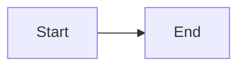
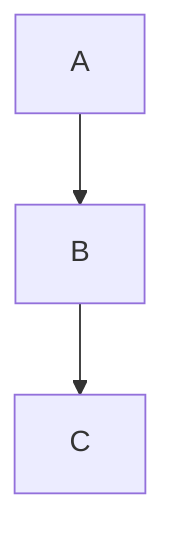

# Diagram Infrastructure Playbook

## Purpose

Document the diagram rendering pipeline: Mermaid → SVG, ASCII art → SVG, with export for review.

---

## Architecture

```
Content (*.md)
     │
     ├── ```mermaid ... ```  →  SVG (placeholder for now)
     │
     ├── ```              →  SVG (ASCII art converter)
     │   [diagram]          
     │   ```                 
     │
     └── dist/diagrams/ ← Exported for external review

Build output:
  dist/
  ├── index.html         (SVG embedded)
  ├── chapter-1.html     (SVG embedded)
  └── diagrams/
      ├── 01-riemannian-geometry-1-ascii.svg
      ├── floor-state-1-mermaid.svg
      └── ...
```

---

## Diagram Types

### Hybrid ASCII‑→‑SVG (new)

The preferred method for Penrose‑style diagrams is the **Hybrid ASCII‑→‑SVG** pipeline. Authors write a fenced code block containing a limited set of ASCII symbols (see the Primitive Symbol Set below). The build step parses this block, converts each symbol into an SVG primitive (line, arrow, shape, or matrix stamp), and emits a deterministic SVG with a fixed `viewBox`.

- **Bounding‑box policy** – The SVG is given a fixed `viewBox` (e.g., `0 0 600 200`). If the diagram exceeds this box, the surrounding `<div class="ascii-diagram">` has `overflow:auto`, providing scrollbars for the reviewer.
- **No pre‑visualisation** – The generator does not attempt to shrink or crop the diagram; reviewers decide whether to split or simplify oversized diagrams after the fact.
- **Vertical ordering (mandatory)** – The half‑space (`---`) is the **floor**: the boundary of the bounded continuum (the Euclidean plane). It is drawn at the *bottom* of the diagram. The 1‑g field (`↓`) lives in the sky above it, pointing **down into** the material. A bio‑tensegrity unit sits between: `↓` (sky) → nodes/stamps (continuum) → `---` (floor). Never invert this.
- **Primitive Symbol Set** – See the **Penrose Symbol Set** section in the Playbook for the exact mapping.

---

## Diagram Types

---

## Penrose Symbol Set (ASCII → SVG)

| Symbol | Meaning | SVG Primitive |
|--------|---------|---------------|
| `---`  | Half‑space (Euclidean plane / ground floor — the boundary of the bounded continuum) | `<line>` spanning the full canvas width, drawn at the **bottom** of the diagram |
| `↓`   | Orthogonal 1‑g vector field arrow (gravity, pointing **down into** the material from above) | `<line>` with arrow marker, repeated on a grid |
| `o`   | Tensor node – circle | `<circle>` |
| `□`   | Tensor node – square | `<rect>` |
| `△`   | Tensor node – triangle | `<polygon>` (triangle) |
| `-`, `|`, `↗`, `↘`, `↖`, `↙` | Leg / tensor rank (direction) | `<line>` (optional arrow marker) |
| `⟲`  | Contraction / loop | `<path>` forming a small loop |
| `=`   | Identity (straight‑through) | `<line>` without marker |
| `▱`   | D’Alembertian (□ = ∂²/∂t² − ∇²) | `<rect class="dalembertian">` (double‑lined box) |
| `◇`   | Elastic‑change matrix (ΔE) | `<polygon>` (diamond) placed on a leg |
| `Δ`   | Thixotropic‑change matrix (Mₜₕᵢₓ) | `<polygon>` (triangle) placed on a leg |
| `⊚`   | Plastic‑remodeling matrix (Rₚₗₐₛₜᵢ𝚌) | `<circle>` with double‑stroke placed on a leg |
| `:::caption:…` | Caption for the diagram | `<text>` below the SVG |
| `:::error:…` | Error / warning marker | `<text>` in red inside a `<g class="diagram-error">` |

These symbols are the only ones the parser recognises. Any other character is ignored (or triggers an error if the `error` block is used). The mapping is deterministic, making the SVG output repeatable and easy to review.

---

## Diagram Types

### 1. ASCII Art Diagrams

Converted to SVG at build time with proper typography.

```markdown
```
[Solid 3-Ball Cylinder] ──► Puncture at Origin ──► [Hollow Torus]
```
```

**Output:** Clean SVG with monospace font, matching column width.

### 2. Mermaid Diagrams

Currently rendered as SVG placeholders (server-side mermaid requires DOM).

```markdown

```

**Note:** For full Mermaid support, consider:
- Client-side rendering (add mermaid.js to template)
- Mermaid CLI in build pipeline
- External rendering tool

### 3. Custom Block Diagrams (:::figure)

For annotated figures with captions:

```markdown
:::figure:1.1:Coordinate transformation
ASCII or embedded content here
:::
```

---

## CSS Styling

Diagrams get automatic styling:

```css
.diagram {
  margin: 1.5em 0;
  padding: 1em;
  overflow-x: auto;
}

.mermaid-diagram svg {
  max-width: 100%;
  height: auto;
}

.ascii-diagram svg {
  border: 1px solid #ddd;
  background: #fafafa;
}

.diagram-error {
  background: #fee;
  border: 1px solid #c00;
}
```

---

## Review Workflow

1. **Build:** `just build --clean`
2. **Preview:** `just preview`
3. **Review embedded:** Open HTML in browser
4. **Review exported:** Open `dist/diagrams/` in design tool (Figma, Illustrator)
5. **Iterate:** Edit source, rebuild, repeat

---

## Adding New Diagrams

### ASCII Art

```markdown
```
[Input] ──► [Process] ──► [Output]
```
```

Use these characters for best results:
- `─►` for arrows
- `[ ]` for boxes
- `│` and `▼` for flow
- Unicode for subscripts/superscripts: `⁰¹²³⁴⁵⁶⁷⁸⁹`

### Mermaid

```markdown

```

Keep diagrams simple — hand-coded is fine.

---

## Future Enhancements

| Enhancement | Status | Notes |
|------------|--------|-------|
| Full Mermaid rendering | Deferred | Requires DOM or CLI |
| Syntax highlighting | Not needed | SVG is rasterized |
| Interactive diagrams | Future | Add client-side JS |
| Automated proof | Not planned | Visual review only |

---

## Related

- `playbooks/penrose-book-playbook.md` — Book formatting
- `playbooks/agent-infrastructure-playbook.md` — Build automation
- `src/agents/diagrams.ts` — Diagram processor source