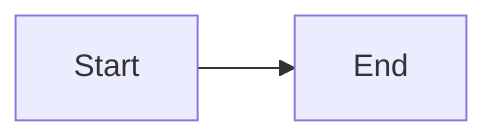

# Diagram Infrastructure Playbook

## Purpose

Document the canonical diagram pipeline for the book: the **Hybrid ASCII→SVG** generator (ADR-002), its recognised symbol set, the authoring workflow, and the review-only conventions. Mermaid is retained as a secondary, placeholder path.

**Authoritative sources for behaviour:** `src/agents/diagram-parser.ts`, `src/agents/diagrams.ts`, `docs/adr/002-hybrid-svg-approach.md`. If this playbook and the code disagree, the code is right — fix the playbook.

---

## Architecture

```
Content (*.md)
     │
     ├── ``` (fenced, no language) ──► isHybridDiagram()? ──► parseDiagram() ──► renderDiagram() ──► true SVG
     │                                                        │
     │                                                        └─ no structural token ──► text-in-<pre> fallback
     │
     └── ```mermaid ... ``` ──► SVG placeholder (Mermaid is not yet rendered server-side)

Build output:
  dist/
  ├── *.html          (SVG embedded inline)
  └── diagrams/       (exported .svg for external review)
```

A fenced code block with no language is the entry point. The build asks `isHybridDiagram()` whether the block uses the hybrid symbol set; if yes, it is parsed into a positional AST and rendered to real SVG primitives. If not, the block falls back to a styled `<pre>` (monospace text) — it does **not** error.

---

## The Hybrid Symbol Set (ASCII → SVG)

These are the only tokens the parser recognises. Anything else is ignored.

| Token | Meaning | SVG primitive |
|-------|---------|---------------|
| `---` (3+ hyphens) | Half-space — the Euclidean plane / floor, the boundary of the bounded continuum | `<line class="diagram-half-space">` spanning the canvas width at that row |
| `↓` `↑` `←` `→` | Field arrow — orthogonal 1-g vector field (canonical direction is `↓`, gravity pointing down into the material) | `<line class="diagram-arrow">` with `marker-end="url(#arrowhead)"` |
| `o` | Tensor node — circle | `<circle class="diagram-node diagram-node-circle">` |
| `□` | Tensor node — square | `<rect class="diagram-node diagram-node-square">` |
| `△` | Tensor node — triangle | `<polygon class="diagram-node diagram-node-triangle">` |
| `—` `–` `-` `─` `━` | Horizontal leg (tensor rank line) | `<line class="diagram-leg">` (runs coalesce) |
| `\|` | Vertical leg (tensor rank line) | `<line class="diagram-leg">` |
| `=` | Identity — straight-through leg | `<line class="diagram-identity">` (runs coalesce) |
| `⟲` | Contraction / loop | `<path class="diagram-contraction">` (small loop) |
| `▱` | D'Alembertian (□ = ∂²/∂t² − ∇²) | `<rect class="diagram-dalembertian">` |
| `◇` | Elastic-change matrix stamp (ΔE) | `<polygon class="diagram-stamp diagram-stamp-diamond">` |
| `Δ` | Thixotropic-change matrix stamp (M_thixo) | `<polygon class="diagram-stamp diagram-stamp-triangle">` |
| `⊚` | Plastic-remodeling matrix stamp (R_plastic) | `<circle>` double-stroke `diagram-stamp diagram-stamp-circle` |

### Gating — what triggers the hybrid renderer

`isHybridDiagram()` requires **at least one structural token**: a node (`o □ △`), a matrix stamp (`◇ Δ ⊚`), a half-space (`---`), a d'Alembertian (`▱`), or a contraction (`⟲`). A lone field arrow (`→`) does **not** trigger hybrid rendering — illustrations and inline prose use `→` for direction, so those fall back to the `<pre>` text renderer. This is deliberate: the hybrid pipeline is for tensor diagrams, not flowcharts.

### Not yet implemented (do not rely on these)

The AST has a `label` kind, but the parser does not yet emit labels — alphanumeric runs are currently ignored. Diagonal leg arrows (`↗ ↘ ↖ ↙`), `:::caption`, `:::error`, and `:::figure` custom blocks are **not** implemented; earlier drafts of this playbook listed them aspirationally. Add them to the parser before documenting them here.

---

## Authoring Workflow

1. **Write plain ASCII inside a fenced code block** (no language tag):
   ```markdown
   ```
   ↓     ↓
   o ──── o
   ---
   ```
   ```
2. **Respect the vertical ordering (mandatory).** The half-space (`---`) is the **floor** — the boundary of the bounded continuum — drawn at the *bottom* of the diagram. The 1-g field (`↓`) lives in the sky above it, pointing **down into** the material. A bio-tensegrity unit sits between: `↓` (sky) → nodes/stamps (continuum) → `---` (floor). Never invert this.
3. **Use at least one structural token** so the hybrid renderer engages (see Gating above).
4. **No extra markup is required.** The symbol set is the markup.

The grid is positional: `col` = character index within a line, `row` = line index. The renderer maps each cell to SVG coordinates deterministically, so the SVG output is repeatable.

---

## Review-Only Conventions

- **No pre-visualisation step.** The generator does not shrink, crop, or auto-fit the diagram. It emits what the author wrote.
- **Overflow is handled by the container.** The SVG's `viewBox` is derived from the grid (`cols × rows` × cell size). The wrapper `<div class="diagram hybrid-diagram">` carries `overflow-x: auto` in `src/styles/pob.css`, so an oversized diagram scrolls horizontally for the reviewer.
- **Reviewers split or simplify after generation.** If a diagram is too dense, the reviewer asks the author to break it into two blocks or drop tokens — there is no automated fix-up.
- **Exported SVGs for external review** live under `dist/diagrams/` and can be opened in any design tool (Figma, Illustrator).

---

## Mermaid (secondary, placeholder)

Mermaid fenced blocks are recognised but rendered as an **SVG placeholder** — server-side Mermaid requires a DOM and is not yet wired in. Treat Mermaid as deferred; prefer the hybrid ASCII pipeline for new diagrams.

```markdown

```

Future options for full Mermaid: client-side `mermaid.js` in the template, the Mermaid CLI in the build, or an external render step. Not planned for the current phase.

---

## CSS

The relevant rules live in `src/styles/pob.css`:

```css
.pob-content .diagram { overflow-x: auto; … }
.pob-content .diagram svg { … }
.pob-content .hybrid-diagram .diagram-half-space,
.pob-content .hybrid-diagram .diagram-leg,
.pob-content .hybrid-diagram .diagram-identity,
.pob-content .hybrid-diagram .diagram-arrow { … }
```

The wrapper class is `hybrid-diagram` (not `ascii-diagram` — that name appeared in earlier drafts and is obsolete).

---

## Review Workflow

1. `just build` (optionally `--clean`).
2. `just preview` — open the HTML; the SVG is embedded inline.
3. For external review, open the exported `dist/diagrams/*.svg` in a design tool.
4. Iterate: edit the source ASCII, rebuild, repeat.

---

## Related

- `docs/adr/002-hybrid-svg-approach.md` — the decision record
- `src/agents/diagram-parser.ts` — the token recogniser and AST
- `src/agents/diagrams.ts` — the SVG renderer and build integration
- `playbooks/epic-hybrid-svg.md` — the epic this pipeline closed
- `playbooks/penrose-book-playbook.md` — book formatting
